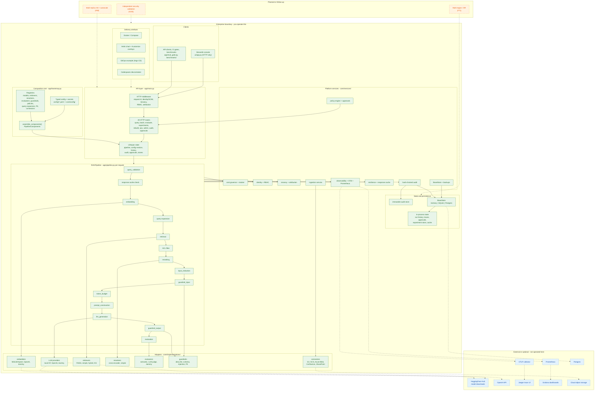

# Architecture diagram

> **High-level view (#188).** A technical reader should understand the platform's
> layers, component boundaries and key request/data flows in about 30 seconds.
> The diagram is Mermaid source rendered by GitHub; edit it here rather than
> exporting a binary. It reflects the code paths in the map below, not aspirational
> capabilities. This is a reference implementation, **not a production-certified product**.

## Legend

- **Green (solid):** implemented in this repository and exercised by tests.
- **Blue (dashed):** external or optional dependency; not shipped or operated by this
  repository.
- **Orange (dotted):** planned / follow-up work, linked to an open issue.

## Diagram

## How to read it

- **Request path:** clients -> HTTP middleware -> routes -> the lifespan-built
  `RAGPipeline` -> adapters. The `pipeline:rebuild` route swaps the pipeline instance
  under a lock; in-flight requests keep the old instance.
- **Trust boundary:** everything in the green enterprise boundary is code you run
  (API, composition root, pipeline, services, adapters, stores, delivery artefacts).
  Blue nodes are external dependencies you point at, not components this repository
  operates.
- **Control plane:** config + registries resolve every vendor-specific component.
  `app/bootstrap.py::assemble_components` is the single assembly path; experiments
  reuse it rather than building components independently.
- **Data and state:** traces, run history, approvals, experiments and the response
  cache are process-local by default (see #191/#192). The audit trail and `BaseStore`
  can persist to SQLite/Postgres; multi-replica coordination and multi-region DR are
  explicitly planned (#68, #71), not claimed.
- **Governance:** identity, RBAC, tenancy, attribution and approvals sit at the API
  edge; guardrails run inside the pipeline on input and output; audit/observability
  capture every request without exposing secrets.

## Component-to-code map

| Diagram area | Code |
| --- | --- |
| HTTP middleware, routes, lifespan state | `app/main.py` |
| Console | `ui/app.py`, `ui/client.py` |
| Composition root | `app/bootstrap.py` |
| Config validation and secrets | `core/config/schema.py`, `core/config/validator.py`, `core/config/secrets.py` |
| Registries | `core/registry/` |
| Pipeline stages | `app/pipeline.py` |
| Interfaces | `core/interfaces/` |
| Adapters | `core/implementations/` |
| Governance, identity, tenancy, attribution, ACL | `core/services/cost_governor.py`, `core/services/policy_engine.py`, `core/services/identity.py`, `core/services/access_control.py`, `core/services/tenancy.py`, `core/services/attribution.py`, `core/services/acl.py` |
| Audit and observability | `core/services/audit_log.py`, `core/services/audit_store.py`, `core/services/observability.py`, `core/services/telemetry.py` |
| Persistence | `core/services/base_store.py`, `core/services/store_backends.py`, `core/services/backup_restore.py` |
| Ingestion and connectors | `core/services/ingestion_service.py`, `core/implementations/connectors/` |
| Evaluation and experiments | `core/evaluation/`, `core/services/experiment_runner.py`, `app/evaluation_api.py` |
| Delivery artefacts | `deployment/Dockerfile`, `deployment/docker-compose.yml`, `deployment/helm/`, `deployment/kustomize/`, `deployment/gitops/`, `.devcontainer/devcontainer.json` |

## Maintaining the diagram

- Update the Mermaid block when a layer, registry, pipeline stage or external
  dependency changes; keep the component-to-code map in sync.
- Move a node from orange to green only when the capability is implemented and tested,
  not when an interface exists.
- `tests/test_architecture_diagram.py` guards the required layers, legend semantics,
  code-map paths and documentation links.
