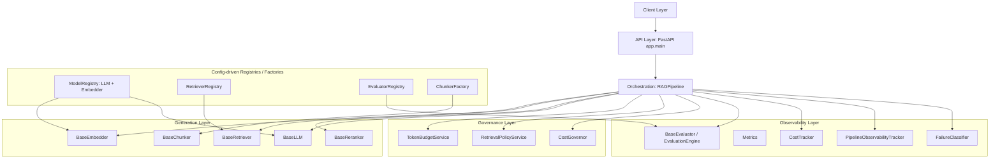
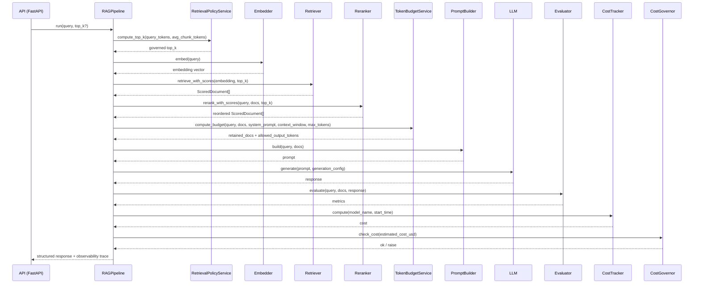
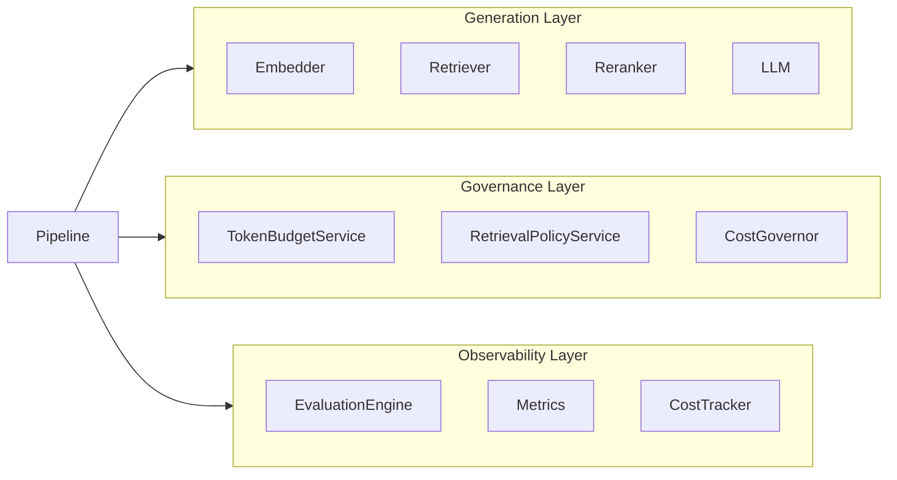
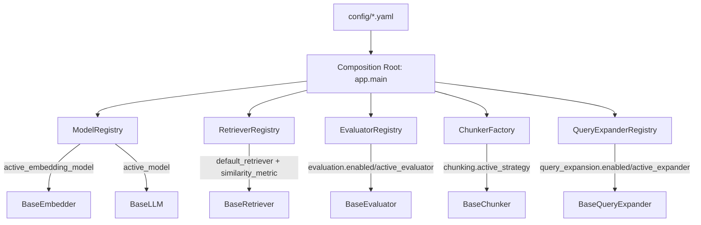
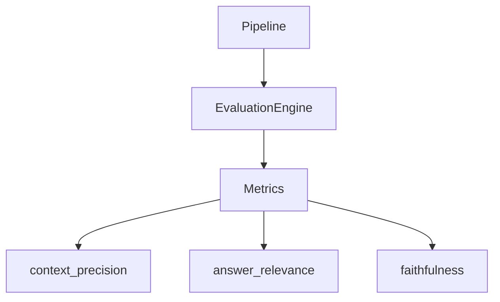
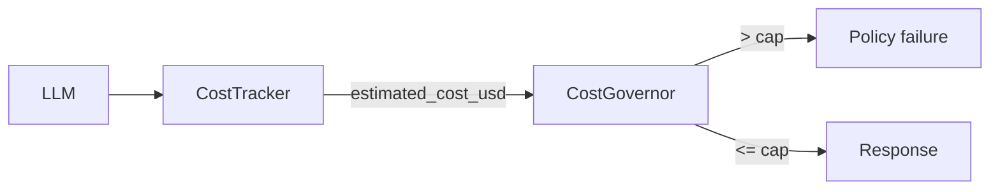

# Enterprise-Grade GenAI Platform Blueprint

## Reusable Platform for Enterprise-grade LLM evaluation and governance

---

# 1. Objective

Enterprises struggle to operationalize GenAI systems due to:

* Lack of measurable evaluation
* Vendor lock-in risk
* Unpredictable cost behavior
* Absence of quality gates
* Poor observability into LLM outputs

This blueprint demonstrates how to architect a **modular, vendor-neutral, evaluation-aware
GenAI platform**. Its central promise is that **behaviour is configuration-driven**: components
can be swapped, quality gates toggled, and cost/observability policies tuned **without editing
the orchestration layer or the API layer**.

## 1.1 What we are NOT building

- A chatbot.
- A LangChain demo.
- A vertical solution.
- A SaaS platform.
- A plug-and-play marketplace.
- A zero-code system.
- A runtime-extensible dynamic plugin system.

## 1.2 What we are building

A reusable enterprise AI platform core — a reference architecture showing how to build a
modular, enterprise-grade GenAI platform, which allows:

* Swap models without rewriting code.
* Swap embedding models without breaking retrieval.
* Turn evaluation on/off.
* Capture cost + metadata.
* Logging, metadata-capture, id-tracing.
* Deploy as a service.

## 1.3 Who would be using it

**AI Platform Engineer (Primary Persona)**

* Fork the repo.
* Extend it.
* Implement vendor integrations.
* Own infra.
* Comfortable writing Python.

---

# 2. System Overview

This is a reference architecture with services, contracts, and deployment models that can be
extended to suit enterprise needs.

## 2.1 Layered view

The system is composed of four layers. Lower layers never reach up; upper layers depend on
lower layers only through **interfaces/contracts** and are wired together by the **composition
root** (see §6).

| Layer | Responsibility | Examples |
|-------|----------------|----------|
| Client Layer | Callers of the platform (apps, CI gates, shadow harness) | HTTP clients |
| API Layer (FastAPI) | HTTP surface, request validation, wiring to the pipeline | `app/main.py` |
| Orchestration Layer | Executes the request lifecycle, enforces stage ordering, emits structured traces | `app/pipeline.py` (`RAGPipeline`) |
| Service Interfaces (contracts) | Stable, swappable contracts for each capability | `core/interfaces/*` |
| Implementation Layer (extension points) | Concrete, replaceable vendors/backends | `core/implementations/*` |
| Registries & Services | Config-driven factories + orthogonal utilities (governance, observability) | `core/registry/*`, `core/services/*` |

## 2.2 Component diagram



## 2.3 Interface Contracts

Each contract is an abstract base class in `core/interfaces/`. Implementations must satisfy the
contract; the orchestration layer depends only on these contracts.

### Embedder Contract (`core/interfaces/embedder.py`)

* Input: `str`
* Output: `List[float]`
* Must expose `dimension` metadata.
* Must expose `model_name` (identifier of the underlying model) so the pipeline can report
  `embedding_model` in traces.

### Retriever Contract (`core/interfaces/retriever.py`)

* Input: embedding vector
* Output: `List[Document]`
* Must expose `index_dimension`.
* Optional: `retrieve_with_scores(...) -> List[ScoredDocument]` to surface per-document
  similarity scores without altering the base `retrieve(...)` contract.

Supporting types:

* `Document(content, metadata, score)` — a retrieved unit of context. `score` is populated
  after retrieval/reranking; `to_dict()` produces a serializable view.
* `ScoredDocument(Document)` — structured `(document, score)` pair supporting attribute access
  (`.document`, `.score`), tuple unpacking `(doc, score)`, and key/index lookup (`["score"]`).

### LLM Contract (`core/interfaces/llm.py`)

* Input: prompt string + `GenerationConfig`
* Output: generated string
* Must expose `context_window` metadata.
* Must expose `model_name` for cost attribution and observability.

### Evaluator Contract (`core/interfaces/evaluator.py`)

* Input: `query`, `retrieved_docs`, `response`
* Output: `metrics` dict (e.g. `context_precision`, `answer_relevance`, `faithfulness`).

### Reranker Contract (`core/interfaces/reranker.py`)

* `rerank(query, documents, top_k) -> List[Document]`
* `rerank_with_scores(query, documents, top_k) -> List[ScoredDocument]`
* `reranker_name` property.

### Chunker Contract (`core/interfaces/chunker.py`)

* `chunk_text(text, metadata) -> List[Document]`
* `chunk_documents(docs) -> List[Document]`
* `chunk(docs_or_text) -> List[Document]`
* `chunk_size`, `chunk_overlap`, `strategy_name` properties.

## 2.4 Structured response

Every request returns a JSON-serializable report. Beyond the baseline contract, the pipeline
adds retrieval scores, latency, failure tags, and an observability trace:

```json
{
  "response": "...",
  "retrieved_docs": ["..."],
  "retrieved_docs_with_scores": [{"content": "...", "score": 0.82, "metadata": {}}],
  "retrieval_scores": [0.82, 0.61],
  "metrics": {
    "context_precision": 0.75,
    "answer_relevance": 0.8,
    "faithfulness": 0.9
  },
  "cost": {
    "model": "dummy",
    "latency_ms": 12.4,
    "estimated_cost_usd": 0.001
  },
  "token_budget": { "budget_mode": "strict", "allowed_output_tokens": 512, "...": "..." },
  "latency": { "embedding": 0.3, "retrieval": 0.2, "total_ms": 12.4 },
  "failure_tags": [],
  "observability": { "request_id": "...", "status": "success", "...": "..." }
}
```

---

# 3. Request Lifecycle (Data Flow)

The `RAGPipeline.run()` method executes ordered stages. Each stage is timed and each failure is
classified (see §8). When `raise_on_failure` is `True` (default), a stage failure raises; when
`False`, a structured degraded response is returned (`status: "failed"`).



**Stage order:** Retrieval depth governance → Embedding → Retrieval → Reranking → Token Budget →
Prompt Construction → LLM Generation → Evaluation → Cost computation → Cost governance.

Note: Reranking is skipped when no reranker is supplied; Evaluation is skipped (empty metrics)
when the evaluator is a no-op/`NullEvaluator`. When a query expander is configured
(`query_expansion.enabled`), the Retrieval stage embeds and retrieves over each query variant and
merges the results (de-duplicated, highest score wins) before Reranking (roadmap #23).

---

# 4. Interface Changes / Extensions

To preserve the existing architecture, all pre-existing interface method signatures remain
intact and backward-compatible. New methods and abstractions are additive. (See also
`INTERFACE_CHANGES.md`.)

| Contract | Added | Purpose |
|----------|-------|---------|
| `Document` | `score`, `to_dict()` | carry/emit relevance score |
| `BaseRetriever` | `retrieve_with_scores()` | expose per-document scores |
| `BaseEmbedder` | `model_name` | observability + registry resolution |
| `BaseReranker` | new interface | pluggable reranking |
| `BaseChunker` | new interface | pluggable chunking strategies |
| `PromptBuilder` | `set_profile()`, `get_system_prompt()`, `list_profiles()` | config-driven prompts |
| `TokenBudgetService` | `strict`/`truncate` modes, retained_docs + counters | explicit budget policy |
| `ModelRegistry` | `register_*`, `get_model`, `get_embedder`, `get_active_embedder` | plug-and-play providers |
| `RAGPipeline` | `reranker`, `top_k`, `config_path`, `raise_on_failure`, governance hooks; richer return | observability + governance |

---

# 5. Separation of Concerns

These layers do not depend on each other and interact only through the pipeline:

### Generation layer
- Embedder
- Retriever
- Reranker
- Chunker
- LLM

### Governance layer
- TokenBudgetService
- RetrievalPolicyService
- CostGovernor

### Observability layer
- EvaluationEngine / Evaluator
- Metrics
- CostTracker
- PipelineObservabilityTracker
- FailureClassifier



## Why this matters

Each layer looks after its own concern, avoiding cross-dependencies. Enterprises can swap
components such as:

```
OpenAI  -> vLLM
Milvus  -> Pinecone
RAGAS   -> internal evaluator
```

without touching the pipeline. That is the whole point of the architecture.

---

# 6. Config-driven Behavior

All runtime behaviour is resolved from `config/*.yaml` at the **composition root**
(`app/main.py`) and inside the pipeline/services. Swapping a component or toggling a policy is a
**config-only** change.

## 6.1 Composition root

`app/main.py` is the composition root. It reads configuration and resolves components through
registries/factories, then injects them into `RAGPipeline`. The intended contract is that the
API/composition layer imports **only interfaces, registries, and factories** — never concrete
implementation classes:

* Embedder: `ModelRegistry.get_active_embedder()` reads `models.active_embedding_model`.
* LLM: `ModelRegistry.get_active_model()` reads `models.active_model`.
* Retriever: `RetrieverRegistry.create()` reads `retrieval.default_retriever` + options.
* Evaluator: `EvaluatorRegistry.create()` reads `evaluation.enabled` + `evaluation.active_evaluator`.
* Reranker/Chunker: resolved from `reranking.*` and `chunking.*` respectively.
* Query expander: `QueryExpanderRegistry.create()` reads `query_expansion.enabled` +
  `query_expansion.active_expander` (roadmap #23).

> **Roadmap note (tracked):** Historically `app/main.py` constructed concrete classes directly
> (e.g. `DummyEmbedder()`, `DummyRetriever()`, `SimpleReranker(...)`). This is being migrated to
> full registry resolution so that config alone selects every component. See issues #5–#10.

## 6.2 Registry / Factory pattern



Each registry follows the same shape:

1. Load its config section.
2. Maintain a `{provider_name: factory}` map (built-ins + `register(...)` for extension).
3. `resolve(name)` → `(key, provider, provider_config)` from config.
4. `create(name?)` → constructed instance (or a Null implementation when disabled).

This is what makes the "add a component, change config, done" workflow possible.

## 6.3 Configuration mapping (reference)

### `config/models.yaml`

| Key | Consumed by | Effect |
|-----|-------------|--------|
| `active_model` | `ModelRegistry.get_active_model()` | Selects the active LLM |
| `models.<name>.provider` | `ModelRegistry` provider map | `dummy` / `local` / `openai` |
| `models.<name>.context_window` | LLM + `RetrievalPolicyService` | Context budget for retrieval depth |
| `models.<name>.temperature` / `max_tokens` | `GenerationConfig` | Generation parameters (roadmap #12) |
| `models.<name>.input_cost_per_1k` / `output_cost_per_1k` | `CostTracker` | Cost computation (roadmap #14) |
| `active_embedding_model` | `ModelRegistry.get_active_embedder()` | Selects the active embedder |
| `embedding_models.<name>` | `ModelRegistry` embedder map | `model_name`, `provider` |

### `config/prompt_config.yaml`

| Key | Consumed by | Effect |
|-----|-------------|--------|
| `active_prompt_profile` | `PromptBuilder` | Selects the default prompt profile |
| `profiles.<name>.system_prompt` | `PromptBuilder` / pipeline | System role for the LLM and token accounting |
| `profiles.<name>.context_separator` | `PromptBuilder` | Joins retrieved documents |
| `profiles.<name>.empty_context_message` | `PromptBuilder` | Fallback when no context is retrieved |
| `profiles.<name>.template` | `PromptBuilder` | Final prompt layout |

### `config/retrieval.yaml`

| Key | Consumed by | Effect |
|-----|-------------|--------|
| `retrieval.default_retriever` | `RetrieverRegistry` | Selects retrieval backend (`faiss`/`simple`/`dummy`/`kg`/`hybrid`) |
| `retrieval.top_k` | `RAGPipeline` | Default number of documents to retrieve |
| `retrieval.similarity_metric` | `RetrieverRegistry` → `FAISSRetriever` | `cosine` / `l2` index selection (roadmap #15) |
| `retrieval.low_score_threshold` | `FailureClassifier` | Flags low-quality retrieval |
| `retrieval.retrievers.<key>` | `RetrieverRegistry` | Provider + options (`documents_path`, `graph_path`, ...) |
| `retrieval.retrievers.kg.graph_path` | `KGRetriever` | Triple store JSON (roadmap #24) |
| `retrieval.retrievers.kg.expansion_hops` | `KGRetriever` | One-hop expansion over shared entities |
| `retrieval.retrievers.hybrid.keyword_weight` | `HybridRetriever` | BM25 lexical weight in fusion (roadmap #25) |
| `retrieval.retrievers.hybrid.vector_weight` | `HybridRetriever` | Vector weight in fusion |
| `evaluation.enabled` | `EvaluatorRegistry` | Toggles evaluation (NullEvaluator when off) |
| `evaluation.active_evaluator` | `EvaluatorRegistry` | Selects evaluator |
| `evaluation.evaluators.<key>` | `EvaluatorRegistry` | Provider mapping |
| `reranking.enabled` | composition root | Enables/disables the reranking stage (roadmap #8) |
| `reranking.strategy` / weights / `top_k` | `SimpleReranker` | Reranking behaviour |
| `chunking.active_strategy` | `ChunkerFactory` | `small` / `large` / custom (roadmap #9) |
| `chunking.strategies.<name>` | `ChunkerFactory` | `chunk_size`, `chunk_overlap`, `separator` |
| `query_expansion.enabled` | `QueryExpanderRegistry` | Enables multi-query retrieval (roadmap #23; default off) |
| `query_expansion.active_expander` | `QueryExpanderRegistry` | Selects expander (`synonym` / `llm` / `noop`) |
| `query_expansion.max_variants` | expanders | Cap on query variants (original always included) |
| `query_expansion.expanders.<key>` | `QueryExpanderRegistry` | Provider mapping (+ `synonyms` for `synonym`) |
| `token_budget.default_mode` | `TokenBudgetService` | `strict` / `truncate` (roadmap #11) |
| `token_budget.max_output_cap` | `TokenBudgetService` | Hard output cap (roadmap #11) |
| `token_budget.min_output_tokens` | `TokenBudgetService` | Minimum reserved output |
| `token_budget.chars_per_token` | `TokenBudgetService` | Token estimation ratio |

Each concern has its own file (like `models.yaml` / `prompt_config.yaml`); the
composition root loads them by explicit path. Legacy deployments that still
carry inline `governance` / `observability` sections inside `retrieval.yaml`
keep working via a fallback (roadmap #34).

### `config/governance.yaml`

| Key | Consumed by | Effect |
|-----|-------------|--------|
| `enabled` | composition root | Gates cost/retrieval-policy enforcement (roadmap #10) |
| `max_cost_per_request_usd` | `CostGovernor` | Cost cap per request |
| `safety_margin_tokens` | `RetrievalPolicyService` | Token safety margin |
| `avg_chunk_tokens` | `RetrievalPolicyService`, pipeline | Chunk size estimate for depth |

### `config/observability.yaml`

| Key | Consumed by | Effect |
|-----|-------------|--------|
| `log_level` | `PipelineObservabilityTracker` | Log verbosity |
| `redact_sensitive_data` | `PipelineObservabilityTracker` | Toggle redaction (roadmap #16) |
| `low_retrieval_score_threshold` | pipeline | Low-score flagging |
| `sensitive_patterns` | `PipelineObservabilityTracker` | Redaction patterns (roadmap #16) |

---

# 7. Vendor Neutrality

Vendor neutrality is achieved by keeping **product-specific code behind interfaces** and
selecting it by configuration:

* Every capability has an abstract contract in `core/interfaces/`.
* Concrete vendors live in `core/implementations/` and expose no vendor types across the
  boundary.
* Registries map a **config key** (e.g. `faiss`, `openai`, `sentence_transformers`) to a
  provider factory. Adding a vendor is: implement the interface → register a factory (or add a
  built-in) → add a config entry.
* The orchestration layer never imports a concrete vendor.

Because of this, swaps that would normally ripple through the codebase become one-line config
changes:

| From | To | Change |
|------|----|--------|
| OpenAI | vLLM / local | `models.active_model` |
| Milvus / Simple | Pinecone / FAISS | `retrieval.default_retriever` |
| Sentence-Transformers | vendor embedding API | `models.active_embedding_model` |
| RAGAS / LLM-judge | internal evaluator | `evaluation.active_evaluator` |

---

# 8. Failure Modes and Policies

The pipeline classifies failures rather than leaking raw exceptions. `FailureClassifier` maps
exceptions and low-quality retrieval to a `FailureType` tag, which is attached to the stage and
recorded in the trace.

## 8.1 Failure taxonomy

| Class | Examples | Failure tags | Mitigation |
|-------|----------|--------------|------------|
| Upstream dependency failure | LLM outage, embedding API failure, vector DB down | `upstream_error` | Fail fast; structured error response; (optional) fallback provider |
| Configuration violation | embedding dimension mismatch, model context overflow, missing config | `dimension_mismatch`, `config_error` | Startup-time validation; hard fail at init (`_validate_contracts`) |
| Retrieval quality | no documents, low similarity scores | `no_documents`, `low_retrieval_score` | Flag as `degraded`; log alert; quality gate (active mode) |
| Policy violation | evaluation below threshold, cost cap exceeded | `cost_exceeded` | Quality gate enforcement (active) / logged alert (passive) |

## 8.2 Behaviour on failure

* `raise_on_failure=True` (default): exception is tagged and re-raised.
* `raise_on_failure=False`: a **degraded** structured response is returned with `status:
  "failed"`, `failed_stage`, `error_message`, empty results, and the recorded `failure_tags`.
* Low-quality retrieval does not fail the request; it marks the trace `degraded` with a
  `low_retrieval_score` tag.

---

# 9. Observability Strategy

Each request produces a structured trace via `PipelineObservabilityTracker`, including:

* `request_id`
* `model_version` / `llm_model`
* `embedding_version` / `embedding_model` + `embedding_dimension`
* `retriever`, `top_k`, `reranker`
* `retrieval_k`, `initial_retrieval_scores`, `retrieval_scores`
* `latency` (per-stage ms + total)
* `cost`
* `evaluation_scores` (`metrics`)
* `failure_tags` and overall `status` (`success` / `degraded` / `failed`)

`SensitiveDataRedactor` scrubs secrets (API keys, tokens, passwords) from traces before they
are logged. Redaction patterns and the enable flag are intended to be config-driven
(`observability.sensitive_patterns`, `observability.redact_sensitive_data`) — currently
hardcoded (roadmap #16).

---

# 10. Evaluation-first Design

Evaluation is a first-class, **pluggable** capability. The `EvaluationEngine` orchestrates a set
of `Metrics`, which declare *how* each metric is computed. Different metric mixes can be
injected per environment.



```python
class LLMJudgeMetrics:      # calls an LLM judge
    def faithfulness(...): ...

class EmbeddingMetrics:     # cosine similarity
    def answer_relevance(...): ...

class HybridMetrics: ...
```

**Pattern:** Strategy + Dependency Injection.

Evaluation can be toggled off via `evaluation.enabled: false`, in which case the
`EvaluatorRegistry` returns a `NullEvaluator` that emits empty metrics at zero cost. This keeps
the pipeline fully functional in passive/shadow mode.

---

# 11. Cost Transparency

Cost is a governance concern surfaced on every response and enforced by `CostGovernor`.

* `CostTracker.compute(model_name, start_time)` returns latency and `estimated_cost_usd`.
* `CostGovernor.check_cost(cost)` raises when `cost > governance.max_cost_per_request_usd`,
  which the pipeline converts into a `cost_exceeded` policy failure.



> **Roadmap note (tracked):** cost is currently a constant stub; the target is to compute cost
> from input/output token counts × per-model `input_cost_per_1k` / `output_cost_per_1k` from
> `models.yaml`. See issue #14. This is required for `CostGovernor` to be meaningful.

---

# 12. Fail-fast Configuration Validation

The blueprint requires invalid configuration to fail **at startup**, not at request time:

* **Startup-time validation:** the composition root resolves every component and validates
  contracts before serving traffic.
* **Hard fail during initialization:** e.g. `RAGPipeline._validate_contracts()` raises a tagged
  `dimension_mismatch` error when `embedder.dimension != retriever.index_dimension`.
* **Model loading:** a missing/unloadable configured model should fail fast with a structured
  error rather than silently falling back to fabricated behaviour.

> **Roadmap notes (tracked):**
> * `SimpleEmbedder` currently falls back to synthetic embeddings on load failure; it should
>   fail fast (opt-in offline fallback only). See issue #18.
> * Config keys that are declared but not yet honored (§6.3 "roadmap" rows) must either be
>   enforced or removed so the contract is truthful.

---

# 13. Deployment Modes

You can use the deployed stack as **active** (a gate) or **passive** (an evaluator) mode. The
architecture supports cut-over from one mode to another.

## Mode 1 — Shadow / Evaluation Mode

Safer; good for early stages. The system:

* Replays queries
* Evaluates responses
* Computes cost
* Logs metrics
* Does **not** block live traffic

Used when the organization is experimenting, governance is not yet enforced, trust is not yet
high, or compliance review is ongoing. Common in BFSI / Healthcare.

## Mode 2 — Inline Gateway Mode

The system acts as an API gateway and blocks traffic that does not meet thresholds:

* Runs retrieval
* Runs evaluation
* Applies quality gates
* Enforces cost thresholds
* Blocks bad responses

This is production-grade governance. Policies and thresholds are configurable and preconfigured
(see §8). The toggle between modes is a matter of whether governance gates raise/block
(`raise_on_failure=True`) or merely log (`raise_on_failure=False`).

---

# 14. Operational Maturity Path

Operationalization is staged — start basic, then level up.

## Stage 1 — Passive Evaluation
Deploy in shadow mode. Replay production queries, evaluate, compute cost, and log
metrics/traces without affecting live traffic. Goal: establish a baseline and trust.

## Stage 2 — Threshold-Based Enforcement
Switch to active governance with conservative thresholds. Enable `CostGovernor` and quality
gates; block only clear violations. Goal: introduce guardrails with minimal business risk.

## Stage 3 — Inline AI Gateway
Act as an inline gateway for production traffic. Enforce quality and cost gates on every
request; emit full observability traces for decision-making. Goal: production-grade governance.

## Stage 4 — Centralized AI Governance Layer
Centralize policy, evaluation, and cost reporting across multiple services. Model swaps and
benchmark updates become routine config/report operations. Goal: platform-wide, explainable AI
governance.

---

# 15. Development & Customization

This is a reference implementation — clone it and use it with little modification. Example: add
a new retriever.

1. Create a new Python file:

   ```
   core/implementations/pinecone_retriever.py
   ```

2. Implement the contract:

   ```python
   class PineconeRetriever(BaseRetriever):
       ...
   ```

3. Register a provider factory (one line) and add a config entry in `retrieval.yaml`
   (`retrieval.retrievers.<key>`).

4. (Advanced) Configure governance/observability hooks (§6.3, §8, §9).

5. Deploy as a Docker container that brings the services up with API endpoints you can plug
   into live production systems for evaluation and report generation (see §13).

Done.

You do **NOT**:

* Call a special API to register.
* Modify docker-compose.
* Modify registry logic (for an existing provider family).
* Touch the orchestration layer.

## 15.1 Adding other components

The same recipe applies to every capability:

| To add a… | Implement | Select via config |
|-----------|-----------|-------------------|
| Retriever | `BaseRetriever` in `core/implementations` | `retrieval.default_retriever` |
| Embedder | `BaseEmbedder` | `models.active_embedding_model` |
| LLM | `BaseLLM` | `models.active_model` |
| Evaluator | `BaseEvaluator` | `evaluation.active_evaluator` |
| Reranker | `BaseReranker` | `reranking.strategy` |
| Chunker | `BaseChunker` | `chunking.active_strategy` |

---

# 16. Repository Layout

```
app/                 API + orchestration (main.py, pipeline.py)
config/              models.yaml, prompt_config.yaml, retrieval.yaml,
                     governance.yaml, observability.yaml
core/
  interfaces/        contracts (embedder, retriever, llm, evaluator, reranker, chunker)
  implementations/   vendor/backend implementations
  registry/          config-driven registries (model, retriever, evaluator)
  services/          governance + observability + prompt/token/cost services
  evaluation/        EvaluationEngine + Metrics
  config/            generation config
data/                sample documents
deployment/          Dockerfile + docker-compose
tests/               unit + integration tests
docs/                architecture.md (this document)
```

---

# 17. Tasks — Broad Level

## Phase 1 — Foundational Blueprint

Focus:
* Abstraction boundaries
* Single-path working reference
* Dockerized API
* Structured JSON response
* Evaluation placeholder
* Cost estimation

Non-goals:
* Production-grade hallucination detection
* Distributed vector DB scaling
* Advanced observability stack

## Phase 2 — Config-driven completion & hardening

Focus:
* Full config-driven composition root (every component resolved from config)
* Honor every declared config flag (reranking/governance/evaluation/token-budget/observability)
* Provider parity: OpenAI honors model + `GenerationConfig`; real cost from token counts
* Fail-fast startup validation and truthful "declared = honored" configs
* Ingestion/chunking stage wired to `chunking.active_strategy`

Tracked via repository issues (#5–#18).

## Phase 3 — Roadmap extensions

Focus:
* Truthful evaluation & benchmarking: real metrics + labeled ground-truth dataset (#21, #22)
* Retrieval breadth: query expansion / multi-query (#23), knowledge-graph retrieval (#24), hybrid keyword + vector (#25)
* Runtime economics: response / prefix caching (#26), batching / parallel inference (#27)
* Governance & platform: audit logging (#28), RBAC / persona control (#29), API hardening (#30)
* Showcase & hygiene: runnable examples + README quickstart (#31), remove dead code (#32)

Derived from the repo's `Daywise-4hourly-execution-plan.csv` (Hour 2-3 build column).

Tracked via repository issues (#21–#32).

---

# 18. References

## Repo

[https://github.com/sujeet-banerjee/enterprise-genai-platform-blueprint](https://github.com/sujeet-banerjee/enterprise-genai-platform-blueprint)

## Interface changelog

`INTERFACE_CHANGES.md`
