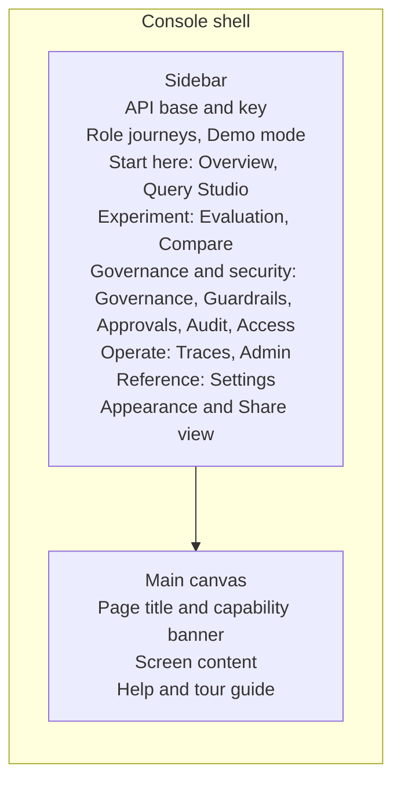
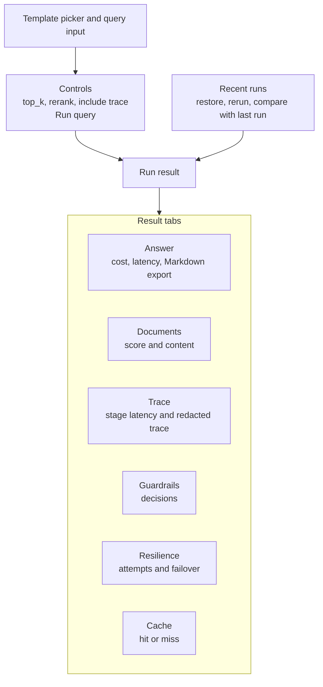
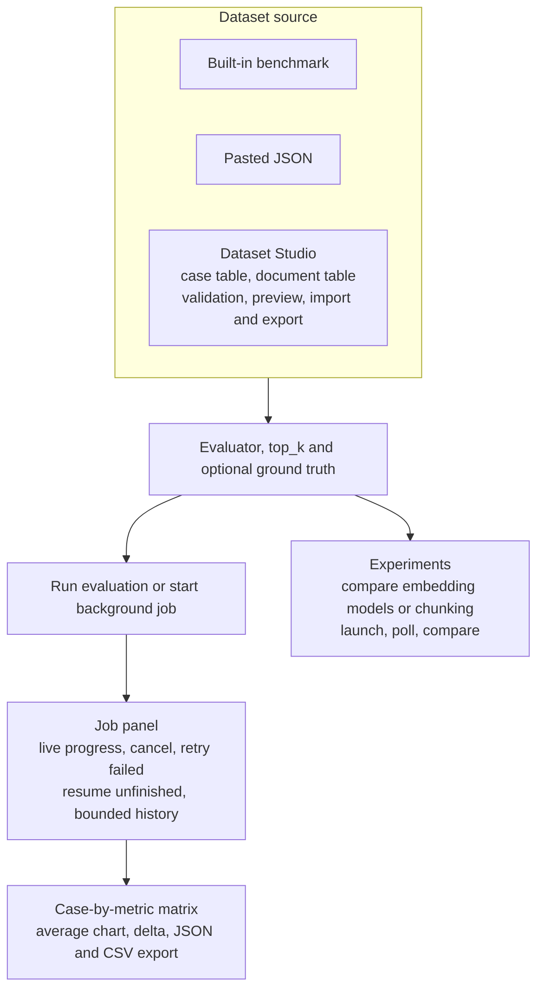
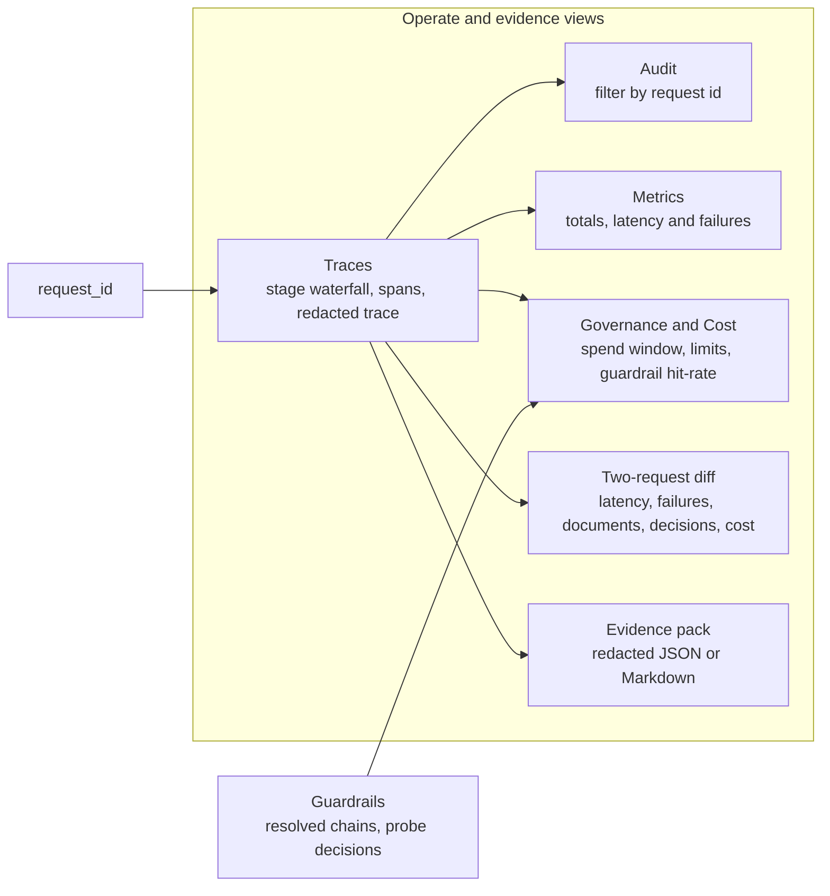

# Streamlit console screen reference

This is the detailed feature reference for the v1 console in `ui/`. The README keeps a short
[quickstart](../README.md#streamlit-console-ux) and a single
[end-to-end click-through scenario](../README.md#end-to-end-scenario-real-retrieval--all-metrics-via-the-console);
this document holds the screen-by-screen detail that used to be collapsed into one long
README paragraph.

> **Screenshot status:** this repository does not ship UX screenshots. Maintainer-linked
> captures for the repeatable [demo walkthrough](showcase/demo-walkthrough.md) are tracked in
> #232 and are explicitly pending. Do not treat the feature lists below as a visual audit.

## Mock-up wireframes

The diagrams below are illustrative Mermaid mock-ups derived from the feature descriptions,
not captured screens and not production data. They render on GitHub and in Markdown viewers
with Mermaid support.

### Console shell and navigation

### Query Studio

### Evaluation and dataset authoring

### Traces, governance and evidence

## Query Studio and recent runs

Open **Query Studio**, apply a **template** (or type a question), set `top_k`, and click
**Run query**. Results are tabbed:

- **Answer** - cost/latency plus a copy/share Markdown export and download.
- **Documents** - retrieved documents with scores.
- **Trace** - per-stage latency and the redacted trace.
- **Guardrails**, **Resilience** and **Cache** - stage-specific diagnostics.

The sidebar keeps a bounded, local **Recent runs** history. Restore a run or run the same
query again to see a **Compare with last run** delta table. **Batch mode** runs one query per
line. API failures render as the failure taxonomy plus a remediation hint
(`failure_type` + `failure_tags`), not stack traces.

## Traces and evidence

Open **Traces** with the returned `request_id` to see the same trace the server logs. The
screen renders a stage timeline/waterfall and links one request across trace, audit, metrics
and governance (#154):

- copy the `request_id` and pivot in one click;
- filter **Audit** by request id;
- compare two requests side by side (stage latency, failure type/tags, retrieved documents,
  guardrail decisions, resilience and cost when recorded);
- download a redacted JSON/Markdown **evidence pack** containing a summary, timeline,
  matching audit events, metrics scope and diff.

Request ids are deep-linkable through the workspace. See
[`docs/ux-and-api.md`](ux-and-api.md) for the route-level page map.

## Evaluation and datasets

The **Evaluation** screen provides a dataset picker (built-in benchmark summary or custom
query/response), ground-truth guidance, metric explanations and a run comparison matrix.

Its **Dataset evaluation** panel runs every built-in or pasted case as a background job
(#152). Each case still goes through `/v1/query` and `/v1/evaluate` with per-case failure
isolation, but the console stays responsive for datasets up to 200 cases. The job panel:

- auto-refreshes with live progress;
- cancels between cases;
- supports **Retry failed cases** and **Resume unfinished cases** (retry results overlay the
  original rows);
- maintains a bounded job history, a case-by-metric matrix and an average-score chart;
- shows a delta against the previous run and supports JSON/CSV export.

Jobs survive a page refresh within the console process and are deep-linkable via the
workspace (`eval_job` parameter).

**Dataset Studio** (#153) authors datasets without raw JSON: case and document tables with
add/remove/reorder, reference/ground-truth and tag fields, inline case-numbered validation
(invalid rows stay in the editor), preview, benchmark-shaped or bare-list import,
round-trip export with redaction, and save/load/duplicate/delete of up to 10 named datasets
persisted through the workspace layer.

The **Compare (what-if)** screen rebuilds the pipeline with overrides when
`api.allow_rebuild=true`. Pair it with the evaluation views to compare cost, latency and
quality between configurations.

## Governance, guardrails, approvals and admin

**Governance & Cost** shows the spend window, metrics, guardrail hit-rate breakdown, time /
tenant / app / user filters, alert previews, CSV/JSON export and a raw Prometheus `/metrics`
panel.

**Guardrails** previews the resolved input/output chains and the selected `profile`, runs a
probe query to show per-request decisions, and reports hit-rate.

**Approvals** is the HITL review queue: a default `pending` view with action/policy/
requester/tenant/age filters, search, sorting, pagination and configurable SLA
warning/critical thresholds. Inspect redacted context/policy and correlation ids, then
approve or reject with an optional reviewer/note. Bulk decisions submit pending items one at
a time after explicit confirmation and report partial failures; export is safe metadata only
(no raw context). The screen requires the `approve` capability.

**Audit** reads the redacted trail with `limit`/`event_type` filters. **Access / RBAC** shows
the calling persona's role and capabilities. **Admin** adds scope indicators, confirmation
prompts and audit export.

## Navigation, onboarding and demo mode

The sidebar groups screens by job (**Start here**, **Experiment**, **Governance & security**,
**Operate**, **Reference**), resolves the caller's role through `GET /v1/access`, lands on the
screen that role usually needs, and hides screens the caller's capabilities cannot open
(the **Show all screens** box previews the full surface).

The **Get started** checklist on Overview walks connect → query → trace → evaluate →
governance + guardrails/audit/admin for roles that hold those capabilities, tracks real
actions, and offers **Quick actions** for the next task.

**Role journeys** (#157) turn onboarding into a short persona-specific path: pick Architect,
Analyst, Security/Compliance, Ops or Admin and the console shows one step at a time with a
goal, a try-it hint and a link to the matching documentation (`< 10` minutes per journey).
**Start / restart**, **Back / Next / Finish** and **Skip** are always available, and visited
screens drive the journey progress bar.

**Demo mode** (#157) seeds the whole console from local fixtures - query history, a saved
dataset, a trace, guardrails, approvals and admin data - and returns a `DemoApi` instead of
the HTTP client, so no backend request is issued and production tenant data is never read or
written. A persistent banner marks demo mode; **Exit demo and reset** clears the seed and
restores a clean workspace. The repeatable maintainer script is in
[`docs/showcase/demo-walkthrough.md`](showcase/demo-walkthrough.md).

## Keyboard, accessibility and appearance

**Command palette (Ctrl+K)** is the keyboard-first launcher (#155): search screens, quick
actions, recent request ids and tenants with `/`, `>`, `#` and `@` prefixes. `?palette=1`
opens it from a deep link and the sidebar button is always available. Browsers may reserve
Ctrl+K; the alternatives are documented in the help overlay. The palette is a plain form, so
it is fully keyboard-operable, and selecting a result navigates with the same
workspace/deep-link state as a click.

**Keyboard shortcuts** opens the same help overlay from the sidebar and lists the keyboard
map, the WCAG 2.2 AA checklist and the documented exceptions. The console injects a skip
link (`Skip to main content`), visible focus rings and a `prefers-reduced-motion` reset;
see [`docs/accessibility.md`](accessibility.md) for the decision record and screen-reader
test script.

The sidebar **Appearance** panel switches **theme** (Light, Dark, High contrast),
**density** (Comfortable, Compact) and **table layout** (Table, Cards) without leaving the
current screen (#156). Breakpoints are tuned for 375/768/1280 px; narrow views reduce
padding and degrade tables to cards that keep every column and action, while desktop keeps
the sidebar actions sticky. Every text/status token meets WCAG 2.2 AA (4.5:1) and chart
colours meet 3:1. Tokens and the degradation contract are documented in
[`docs/layout-and-theme.md`](layout-and-theme.md); `ui/theme.py` holds the pure helpers. The
visual design, information hierarchy and incremental polish plan are reviewed in
[`docs/ui-enterprise-look-and-feel-plan.md`](ui-enterprise-look-and-feel-plan.md).

## Persistent workspace

The console keeps a persistent workspace across reloads and share links (#151). Screen,
query, filters, selected trace, comparisons, datasets and saved views are encoded in
managed URL parameters (`screen`, `request_id` and the compact `ws` payload), so copying the
address bar reproduces the current view.

Use the sidebar to **Share this view** (bounded to 12,000 characters; bulky datasets/history
are trimmed first), **Save view** on any screen, **Pin selected run** in **Recent runs**, or
**Export workspace** / **Import workspace** as redacted JSON. **Reset workspace** clears it.
URLs and exports are redacted and never contain secrets or raw config; saved views are
capped at 5 per screen and saved runs at 20. The Streamlit dependency is pinned to `>=1.65`
for query-param back/forward support.

## First-time entry points

- **Take the tour** - guided step-by-step walkthrough of every screen (Back / Next / Skip).
- **Role journey** - persona-sized path through the screens relevant to one job.
- **Demo mode** - explore seeded fixtures without a backend.
- **Help & tour guide** - the same reference available at any time.
- **Command palette (Ctrl+K)** - keyboard-first navigation; search `shortcuts` for the key map.
