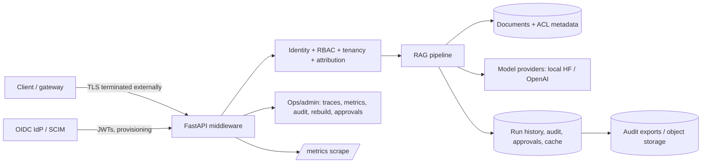

# Threat model

> Scope: the application layer shipped in this repository, its configuration defaults
> and the operational surfaces an adopter exposes. This model is reviewed alongside
> [test-plan.md](test-plan.md) and [README.md](README.md); it is not a certification.

Baseline: `main` @ `ca95215` (2026-11-15). Re-review when a trust boundary or a security
control changes.

## 1. Assets

| Asset | Why it matters | Where it lives |
| --- | --- | --- |
| Retrieved documents and their ACL metadata | May contain tenant-confidential content; ACLs are the only per-document control | Loaded by retrievers from `data/` or connectors |
| Generated answers and prompts | May contain injected instructions, PII, or cross-tenant context | `app/pipeline.py`, model providers |
| Tenant/identity attribution | Determines cache namespace, spend, audit and ops scoping | `core/services/tenancy.py`, `attribution.py`, `acl.py` |
| Credentials: API keys, JWT secret/JWKS, SCIM tokens, provider keys | Grant API, provisioning or upstream access | `config/*.yaml` via `${VAR}` / `env:` refs, environment |
| Audit trail and evidence exports | Non-repudiation and compliance evidence | `core/services/audit_log.py`, immutable sink, export dir |
| Traces, metrics, run history | Contain query text, stages, cost, failure reasons; used for operations | `core/services/observability.py`, `app/ops_api.py` |
| Configuration and model/provider selection | Can disable controls or redirect traffic | `config/**/*.yaml`, `/v1/pipeline:rebuild` |
| Availability and provider budget | Abuse drives cost and denies service to others | API, batch, provider calls |

## 2. Trust boundaries

Threat boundaries crossed: client→API (authentication), API→tenant scope
(authorization), pipeline→corpus (document ACLs), pipeline→providers (data egress),
app→persistence/telemetry (confidentiality and integrity), operator→admin surfaces
(privilege), build→runtime (supply chain).

## 3. Attacker assumptions

In scope:

- **Unauthenticated remote attacker** who can reach exposed ports.
- **Authenticated low-privilege caller** (viewer/analyst) with a valid credential.
- **Malicious or compromised tenant** sharing a deployment.
- **Malicious document author** who can place content in a retrieved corpus (indirect
  injection).
- **Compromised dependency or CI credential** (supply chain).
- **Privileged insider** with operator/API admin capability (limited: host/root
  compromise is out of scope).

Capabilities assumed: can send arbitrary headers, queries, batches and file attachments
where an endpoint accepts them; can read documentation and public code; can retry and
adapt. Cannot break TLS, forge a valid IdP signature, modify the host, or read process
memory from outside.

## 4. Abuse cases

Priority: **P0** = blocks a security claim or tenant boundary; **P1** = meaningful
confidentiality/integrity risk in a common configuration; **P2** = hardening or
defense-in-depth.

| ID | Priority | Abuse case | Impact | Primary control | Residual |
| --- | --- | --- | --- | --- | --- |
| T-AUTH-1 | P0 | Submit `alg: none` or algorithm-confusion token | Authentication bypass | Algorithm allowlist in `JwtVerifier`; required `exp`/`sub` | Relies on PyJWT; pinned |
| T-AUTH-2 | P0 | Forge a token with the wrong secret/key, wrong issuer/audience, or an expired token | Impersonation | Signature, issuer, audience, expiry and leeway validation | Key management is adopter-owned |
| T-AUTH-3 | P1 | Call protected endpoints with no credentials, or rely on anonymous default | Unauthorized access | `identity.enabled` + `allow_anonymous: false`; API-key stub when identity off | Defaults are off (F-02) |
| T-AUTH-4 | P1 | Reuse or guess a SCIM bearer token to create/modify users and groups | Privilege escalation via provisioning | Dedicated SCIM token set; disabled → 404; bad token → 401 | Static shared secret (F-08) |
| T-RBAC-1 | P0 | Viewer/analyst invokes rebuild, audit, metrics, evaluate, approvals | Unauthorized admin action or data read | Path→capability map enforced in middleware | Role config is adopter-owned |
| T-RBAC-2 | P1 | Role with no `query` capability still reaches retrieval/generation | Unauthorized model/corpus use | Capability check precedes handler | — |
| T-RBAC-3 | P2 | Probe public paths (`/health`, `/ready`, `/metrics`, OpenAPI) for tenant data | Information disclosure | Public allowlist excludes tenant-scoped state | `/metrics` aggregate labels exposed (F-11) |
| T-TENANT-1 | P0 | Send `X-Tenant-ID` for another configured tenant | Cross-tenant cache/history/experiment/audit access, budget abuse | Identity claim/key binds the caller; contradiction → 403 unless role/key allowlisted (`tenants.header_override`) and denial audited | **Fixed** (#223) when identity is enabled; identity-disabled legacy mode is gateway-trust (F-01 residual) |
| T-TENANT-2 | P0 | Reuse another tenant's cached answer via cache key collision | Cross-tenant confidential response | Cache key includes tenant/workspace/app/user and ACL scope | Only when tenancy active; default single tenant |
| T-TENANT-3 | P0 | Read traces/metrics/experiments/audit across tenants by request id or `?tenant` | Cross-tenant operational data | Ops reads scoped to caller tenant; mismatch → 403/404 | Header spoofing closed by #223 when identity is enabled |
| T-ACL-1 | P0 | Retrieve a restricted document through over-fetch, query expansion, KG expansion, reranking or a different retriever | Document confidentiality breach | Filter immediately after retrieval, before rerank/prompt; all backends tested | Documents without ACL metadata follow `default_policy` |
| T-ACL-2 | P1 | Serve a cached answer produced for another role/group | Indirect document disclosure | ACL scope (tenant/groups/roles) in cache key | Only when ACL enabled |
| T-GUARD-1 | P1 | Direct prompt injection / jailbreak in the query | Policy bypass, instruction leak | `injection` guardrail blocks over threshold | Heuristic (F-03); off by default |
| T-GUARD-2 | P1 | Indirect injection in a retrieved document | Model follows attacker instructions | Untrusted-document neutralization (mask + delimit) unless explicitly trusted | Heuristic; trusted mode disables it |
| T-GUARD-3 | P2 | Bypass guardrails via paraphrase/encoding, or rely on fail-open default | Policy bypass | Sensitivity thresholds; classifier extension point | **Accepted** fail-open when disabled (F-03) |
| T-LEAK-1 | P0 | Read secrets from `/v1/config`, introspection, rebuild echo or error bodies | Credential compromise | Secrets stripped/redacted; env values never resolved into responses | Custom free-text config fields may leak (F-12) |
| T-LEAK-2 | P0 | Find bearer tokens, API keys or PII in traces, audit, logs or error envelopes | Credential/PII disclosure | Trace redactor, audit redaction, error envelopes omit credentials | In-memory stores (F-07); retention limits |
| T-LEAK-3 | P1 | PII sent in query/documents reaches provider prompt, answer, trace or audit | Privacy/compliance breach | Optional PII guardrail + input redaction; trace redactor | Off by default; regex/NER limits |
| T-DOS-1 | P1 | Oversized query, maximum batch, or high request rate | Resource exhaustion, provider cost | Query-length bound, batch size/worker caps, tenant budget | **No rate limiting** — F-04 / #224 |
| T-ADMIN-1 | P0 | Call rebuild or governance override without authorization | Control bypass / config tampering | Capability `rebuild`, `api.allow_rebuild` default false, governance opt-in | Admin role is powerful by design |
| T-AUDIT-1 | P1 | Modify/delete audit records or purge without authority | Loss of evidence | Hash chain + verify; purge requires `governance`; export before delete | Single-principal purge (F-10); memory default (F-07) |
| T-SUPPLY-1 | P1 | Vulnerable dependency or malicious CI change ships unnoticed | Code execution / data exposure | Pinned deps, CodeQL advisory, Dependabot alerts, secret push protection | No required SCA/image scan — F-05 / #225 |

## 5. Assumptions and out of scope

- TLS, network segmentation, WAF, DDoS protection and IdP hardening are adopter
  responsibilities; the repository documents expectations but does not enforce them.
- No claim is made about resistance to a well-resourced, adaptive attacker or about
  foundation-model safety behaviour.
- Model/provider data-retention and training policies are external; enabling a remote
  provider moves data across a new boundary.
- Multi-replica consistency and disaster recovery are covered by #206 and
  [`dr-runbook.md`](../dr-runbook.md), not by this model.
- Findings accepted in [README.md](README.md) remain risks. The threat model does not
  mitigate them by describing them.
